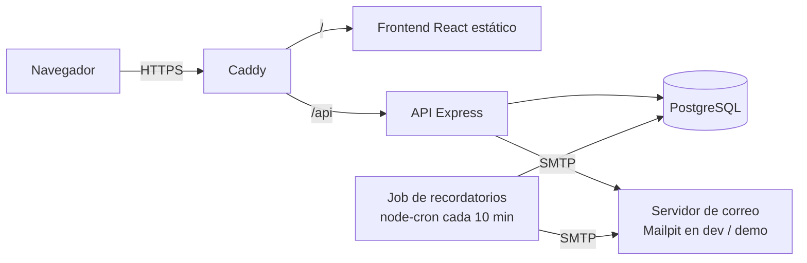
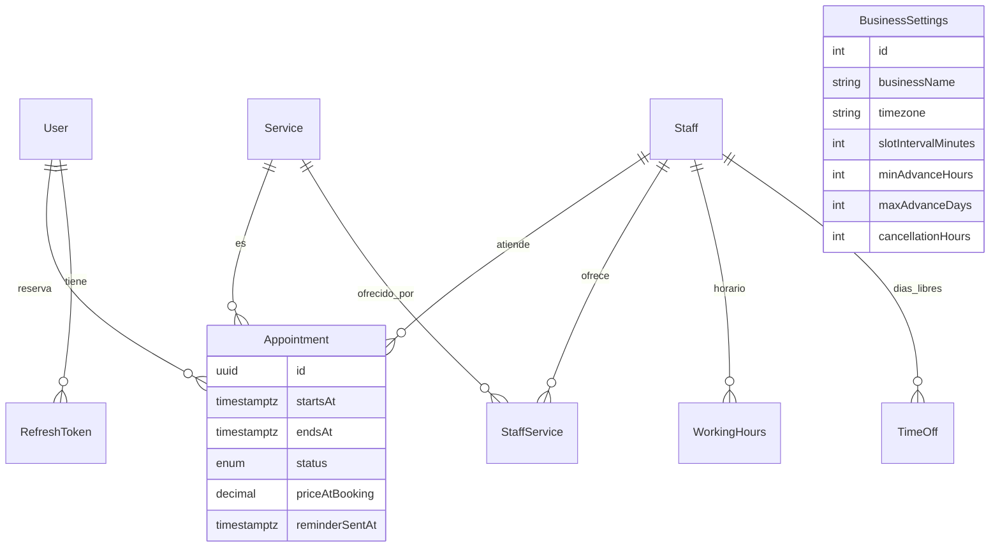

# ReservaYa

Sistema de gestión de citas en línea para negocios locales (barberías, clínicas, salones).
Los clientes reservan por sí mismos; el negocio administra servicios, profesionales, horarios y ve estadísticas.

**Demo:** _pendiente de desplegar_ · **API:** `/api/docs` (Swagger)

| Rol     | Correo                   | Contraseña    |
| ------- | ------------------------ | ------------- |
| Admin   | `admin@reservaya.demo`   | `Admin1234`   |
| Cliente | `cliente@reservaya.demo` | `Cliente1234` |

> Especificación completa y decisiones técnicas en [`reservaya-especificacion.md`](./reservaya-especificacion.md).

## Capturas

_Pendientes: inicio, flujo de reserva en móvil, dashboard y agenda._

## Funcionalidades

- **Clientes:** registro e inicio de sesión, asistente de reserva en 4 pasos (servicio → profesional o "cualquiera" → fecha y hora → confirmar), "Mis citas" con cancelación (respetando la anticipación mínima), perfil.
- **Administrador:** dashboard con métricas y gráficas, agenda diaria por profesional, tabla de citas con filtros y paginación, cambio de estado (completada / no asistió), gestión de servicios, profesionales, horarios semanales por bloques, días libres y configuración del negocio.
- **Sistema:** correos de confirmación y cancelación, recordatorios automáticos 24 h antes, protección contra reservas dobles a nivel de base de datos, modo demo con reinicio nocturno de datos.

## Stack

| Capa          | Tecnología                                                             |
| ------------- | ---------------------------------------------------------------------- |
| Frontend      | React 19, Vite, TypeScript, Tailwind CSS 4, TanStack Query, React Hook Form + Zod, Recharts |
| Backend       | Node 24, Express 5, TypeScript, Zod, pino, node-cron, Nodemailer      |
| Datos         | PostgreSQL 16, Prisma 7 (driver adapter `pg`)                          |
| Pruebas       | Vitest, Supertest, Testing Library                                     |
| Infraestructura | Docker, Caddy (HTTPS automático), GitHub Actions, GHCR, AWS EC2      |

## Arquitectura



## Modelo de datos



## Decisiones técnicas destacadas

- **Restricción de exclusión en PostgreSQL** (`EXCLUDE USING gist` sobre `staffId` y `tstzrange(startsAt, endsAt)` para citas activas). El código valida antes, pero ante dos peticiones simultáneas solo la base de datos puede garantizar que una falle; el backend traduce el error `23P01` a un **409**. Hay una prueba que lanza 5 reservas a la vez y comprueba que exactamente una tiene éxito.
- **Límite de citas futuras dentro de la transacción**, con `SELECT … FOR UPDATE` sobre el cliente: dos reservas simultáneas del mismo cliente se serializan y el límite no se puede superar.
- **Fechas en UTC, zona horaria del negocio solo para calcular y mostrar.** Los horarios semanales se guardan como `"09:00"` locales y se convierten con `@date-fns/tz` el día concreto, así el cambio de horario de verano no afecta.
- **Disponibilidad como función pura** (`availability.core.ts`): recibe horario, días libres y citas y devuelve los huecos. Se prueba de forma unitaria con los casos límite (almuerzo, citas que bloquean, canceladas que no, anticipación mínima y máxima, UTC-6).
- **Refresh tokens rotativos con detección de reutilización** y un periodo de gracia de 30 s para pestañas múltiples. El access token (15 min) vive solo en memoria; el refresh va en cookie `httpOnly` + `sameSite=strict` con ruta `/api/auth`.
- **Los cambios del admin no tocan citas confirmadas.** Cambiar un horario, añadir un día libre o desactivar a alguien devuelve la lista de citas afectadas para que el admin decida.
- **Recordatorios idempotentes:** el job reclama cada cita con un `UPDATE … WHERE reminderSentAt IS NULL` antes de enviar, así dos pasadas concurrentes nunca duplican correos.
- **Imágenes construidas en CI y publicadas en GHCR.** El servidor solo hace `pull`: una EC2 pequeña no tiene memoria para compilar.

### Decisiones de implementación (puntos ambiguos de la especificación)

- "Próximas" en Mis citas son las confirmadas futuras; todo lo demás (pasadas, canceladas, completadas, no asistidas) va a "Historial".
- La ocupación por profesional cuenta minutos de citas confirmadas, completadas y no asistidas sobre los bloques de horario del rango; los días libres no se descuentan.
- La agenda del admin muestra de 07:00 a 21:00 y solo la vista por día (la semanal queda como mejora).
- El límite de citas futuras es 5 (la especificación original decía 3; con 3 el cliente demo se quedaba sin cupo).
- Al cancelar, se guarda quién lo hizo (`cancelledBy`) y el correo lo indica.
- En modo demo no existe ningún endpoint para cambiar contraseña o correo, así que no hace falta bloquearlos; sí se bloquea cambiar el nombre del negocio.

## Correrlo en local

Requisitos: Node 24 y Docker (Docker Engine en WSL 2 sirve; no hace falta Docker Desktop).

```bash
cp .env.example .env
npm install
docker compose up -d db mailpit
npm run db:migrate
npm run seed
npm run dev
```

- Frontend: http://localhost:5173
- API: http://localhost:4000/api/health
- Documentación de la API (Swagger): http://localhost:4000/api/docs
- Correos de prueba (Mailpit): http://localhost:8025

También puede levantarse todo en contenedores con `docker compose up`.

### Nota para Windows 10 con Docker en WSL 2

WSL apaga su máquina virtual pocos segundos después de que termine el último proceso, y con ella los contenedores.
Para evitarlo hay que dejar un proceso vivo dentro de la distribución, por ejemplo con una tarea programada al iniciar sesión:

```powershell
schtasks /Create /F /SC ONLOGON /TN "WSL Docker keep-alive" /RL LIMITED /TR "powershell.exe -NoProfile -WindowStyle Hidden -Command \"wsl.exe -d Ubuntu --exec sleep infinity\""
```

## Scripts

| Comando                 | Qué hace                                        |
| ----------------------- | ----------------------------------------------- |
| `npm run dev`           | Backend y frontend con recarga en caliente      |
| `npm run lint`          | ESLint en todo el monorepo                      |
| `npm run typecheck`     | `tsc` en backend y frontend                     |
| `npm test`              | Pruebas (backend necesita la base `db`)         |
| `npm run test:coverage` | Pruebas con cobertura (backend exige ≥ 70 %)    |
| `npm run format`        | Prettier                                        |
| `npm run db:migrate`    | Crea/aplica migraciones de Prisma               |
| `npm run seed`          | Limpia la base y carga los datos de demo        |
| `npm run build`         | Compila backend (`dist/`) y frontend            |

## Pruebas

- **Backend** (`backend/tests`): 80 pruebas con Vitest + Supertest contra una base de datos real (`reservaya_test`, migrada en el `globalSetup`). Unitarias de disponibilidad; integración de auth, catálogo, citas (incluida concurrencia), correos, recordatorios, estadísticas, seed y documentación. Cobertura ≈ 90 %.
- **Frontend** (`frontend/src/**/*.test.tsx`): Testing Library con las API mockeadas: validación de formularios, asistente de reserva, rutas protegidas, "Mis citas".

```bash
npm test
```

## Despliegue en AWS EC2

El flujo: un push a `main` ejecuta CI (lint, typecheck, pruebas, build); si pasa, `deploy.yml` construye las imágenes, las publica en GHCR y entra por SSH al servidor para hacer `docker compose pull && up -d`. Las migraciones se aplican en un contenedor `migrate` del que depende el backend.

### 1. Instancia

1. Crea una instancia **Ubuntu 24.04** (t3.micro o t3.small; comprueba qué incluye la capa gratuita de tu cuenta y crea una **alarma de facturación**).
2. Grupo de seguridad: entrada **22** (solo tu IP), **80** y **443** (0.0.0.0/0).
3. Asigna una IP elástica y apunta un dominio o subdominio a ella (registro A). Caddy obtiene el certificado automáticamente; sin dominio puede usarse un subdominio gratuito tipo DuckDNS.

### 2. Servidor

```bash
# Docker Engine + Compose
curl -fsSL https://get.docker.com | sudo sh
sudo usermod -aG docker $USER && newgrp docker

# Código y configuración
sudo mkdir -p /opt/reservaya && sudo chown $USER /opt/reservaya
git clone https://github.com/TU-USUARIO/reservaya.git /opt/reservaya
cd /opt/reservaya
cp .env.example .env
```

Edita `.env` con valores reales: `POSTGRES_PASSWORD`, `JWT_ACCESS_SECRET` (`openssl rand -hex 32`), `DOMAIN=tu-dominio`, `APP_URL=https://tu-dominio`, `IMAGE_PREFIX=ghcr.io/tu-usuario/reservaya`, datos SMTP reales (o `DEMO_MODE=true` y `COMPOSE_PROFILES=demo` para la demo pública con Mailpit).

Primer arranque (antes de que exista el pipeline, o para probar):

```bash
docker compose -f docker-compose.prod.yml up -d --build
# Datos de demo (opcional)
docker compose -f docker-compose.prod.yml run --rm migrate npx prisma db seed
```

### 3. GitHub

Secrets del repositorio: `EC2_HOST`, `EC2_USER` (normalmente `ubuntu`) y `EC2_SSH_KEY` (clave privada). Las imágenes se publican con el `GITHUB_TOKEN`; en el servidor el workflow hace `docker login ghcr.io` con ese mismo token. Si el repositorio es privado, marca los paquetes como accesibles para el repositorio en la configuración de GHCR.

### 4. Backups

```bash
chmod +x scripts/*.sh
crontab -e
# 0 2 * * * /opt/reservaya/scripts/backup-db.sh >> /var/log/reservaya-backup.log 2>&1
```

Copia diaria con `pg_dump` en `/opt/reservaya-backups`, conservando 7 días. Restaurar: `scripts/restore-db.sh <archivo.sql.gz>`.

## Próximas mejoras

- Recordatorios por WhatsApp (API de WhatsApp Business o Twilio).
- Exportar citas a CSV.
- Recuperación de contraseña por correo.
- Reprogramar cita en lugar de cancelar y volver a reservar.
- Lista de espera cuando un día está lleno.
- Vista semanal en la agenda del admin.
- Modo multi-negocio (multi-tenant).
